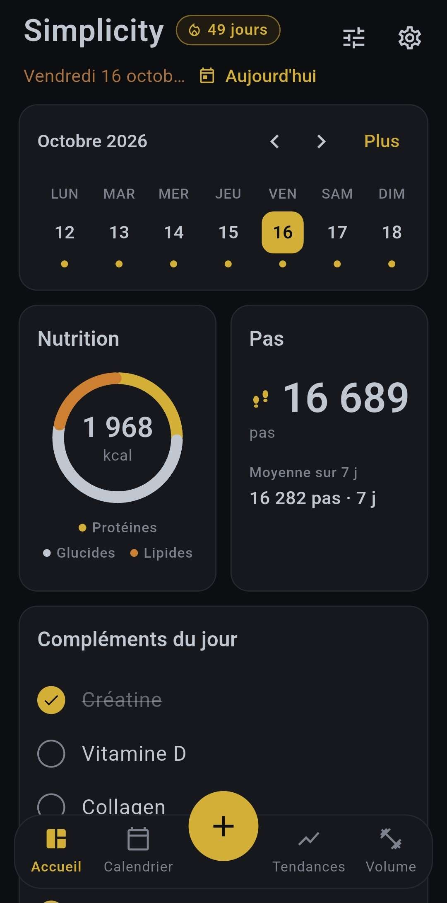
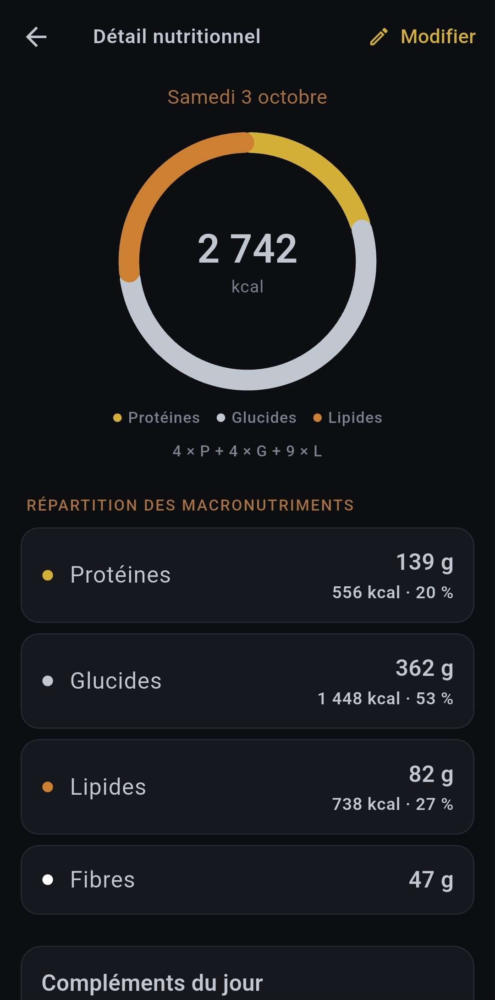
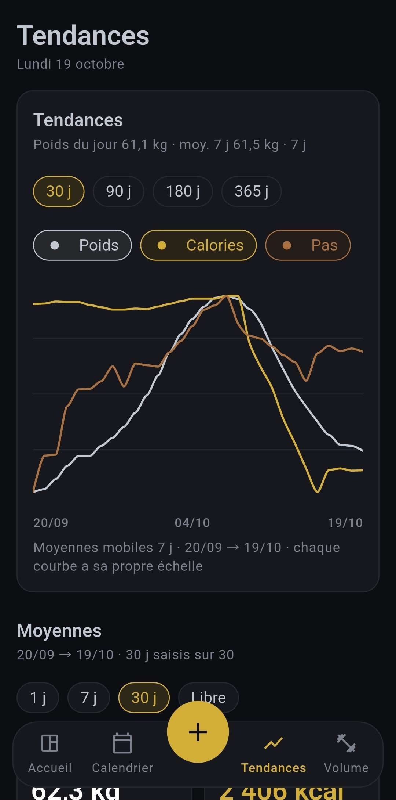
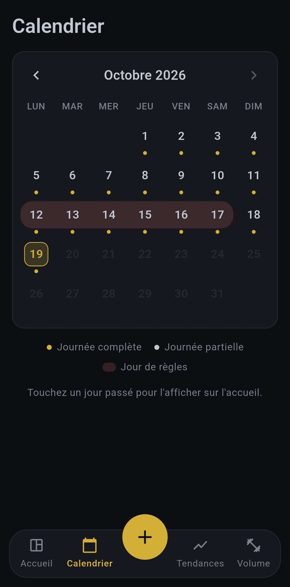

<div align="center">

# Simplicity

**Tableau de bord minimaliste et local-first pour la culture physique**
_A minimalist, local-first dashboard for physical training_


[Français](#français) · [English](#english)

</div>

---

## Français

Simplicity est un **instrument de bord** pour les pratiquants avancés qui mesurent déjà leurs données. L'application observe vos tendances réelles (poids, apports, pas, volume d'entraînement) sur des fenêtres calendaires glissantes, et vous laisse décider. Elle ne prescrit rien.

### Philosophie et engagements

- 🔒 **100 % local-first** : vos données vivent dans une base SQLite sur votre téléphone. Aucun cloud tiers, aucun serveur distant.
- 🚫 **Zéro publicité, zéro cookie de traçage, aucun compte requis.** Pas d'outil de mesure d'audience ni de télémétrie.
- 🌊 **Système fluide** : Conçu pour fournir un suivi factuel, pas d'émotions, que des données :
  - **Volume glissant** par groupe musculaire, sur 7 à 13 jours, comparé à vos propres repères ;
  - **Donut des macros** (protéines, glucides, lipides, fibres), calories calculées à partir des macros ;
  - **Pas**, sur 7, 30, 90 ou 365 jours ;
  - **Tendances lissées** : courbes superposées du poids, des calories et des pas (moyenne mobile sur 7 jours), moyennes avec leur nombre de jours réellement saisis, variation hebdomadaire du poids ;
  - **Cycle menstruel** (facultatif, désactivé par défaut) : périodes de règles, durées moyennes calculées sur les cycles clos, début estimé des prochaines règles.
- ✍️ **Une donnée non saisie reste vide** : elle s'affiche « — » et n'est jamais comptée comme un zéro dans une moyenne.

### Modèle économique transparent

- **Essai gratuit de 31 jours, sans aucune restriction.**
- **Achat unique à vie**, au montant de votre choix : **1,99 €**, **4,99 €** ou **9,99 €**. Les trois paliers débloquent exactement la même version complète. Les prix sont affichés dans la devise de votre compte de boutique.
- **Aucun abonnement récurrent.** Un achat se restaure gratuitement sur un nouveau téléphone (« Restaurer mes achats »).
- **Portabilité totale** : export et import de toutes vos données en classeur Excel (.xlsx), à tout moment, y compris après la fin de l'essai.

### Aperçu

|                Tableau de bord                |                Détail nutritionnel                |              Tendances               |               Calendrier                |
| :-------------------------------------------: | :-----------------------------------------------: | :----------------------------------: | :-------------------------------------: |
|  |  |  |  |

### Téléchargement

<a href="https://play.google.com/store/apps/details?id=com.hobagi.fluidtracker.fluid_tracker"></a>

**App Store** : bientôt disponible.

### Support, bogues et suggestions

Ce dépôt sert de point de contact. Pour nous écrire, [ouvrez une issue](https://github.com/JoGacon/Simplicity-contact/issues/new) en suivant l'un des modèles ci-dessous. Avant de publier, vérifiez qu'une issue similaire n'existe pas déjà.

> ⚠️ N'incluez jamais vos données de santé (poids, cycle…) ni votre fichier d'export dans une issue : elle est publique.

#### 🐛 Signaler un bogue

Titre : `[Bogue] Résumé en une phrase`

```markdown
**Comportement attendu**
Ce que l'application aurait dû faire.

**Comportement observé**
Ce qu'elle a fait à la place (message d'erreur, écran concerné).

**Étapes pour reproduire**

1. …
2. …

**Appareil**

- Modèle du smartphone : (ex. Pixel 8, Galaxy S23)
- Version d'Android ou d'iOS : (ex. Android 15)
- Version de Simplicity : (fiche de l'application dans la boutique, ou Paramètres du téléphone › Applications › Simplicity)
```

#### 💡 Proposer une amélioration

Titre : `[Idée] Résumé en une phrase`

```markdown
**Type de suggestion**
Nouvelle métrique / retour ergonomique / autre

**Description**
Ce que vous aimeriez voir, et dans quel écran.

**Pourquoi**
Le besoin ou la situation qui motive la proposition.
```

Les suggestions sont lues avec attention. Pour rester fidèle à sa philosophie, Simplicity n'ajoutera ni objectif imposé, ni score, ni jugement sur vos valeurs.

### Confidentialité et données de santé

Simplicity ne transmet aucune donnée de santé ni de cycle à un serveur. Le détail figure dans la **[politique de confidentialité](PRIVACY.md)**.

---

## English

Simplicity is a **dashboard instrument** for advanced trainees who already measure their data. It shows your real trends (weight, intake, steps, training volume) over rolling calendar windows, and lets you decide. It never prescribes anything.

### Philosophy and commitments

- 🔒 **100% local-first**: your data lives in a SQLite database on your phone. No third-party cloud, no remote server.
- 🚫 **No ads, no tracking cookies, no account required.** No analytics, no telemetry.
- 🌊 **Seamless Tracking**: no calorie target, no remaining "budget", no score, no warning colours. Factual tracking only:
  - **Rolling volume** per muscle group over 7 to 13 days, compared with your own reference points;
  - **Macro donut** (protein, carbs, fat, fiber), with calories computed from macros;
  - **Steps** over 7, 30, 90 or 365 days;
  - **Smoothed trends**: overlaid weight, calorie and step curves (7-day moving average), averages with the number of days actually logged, weekly weight change;
  - **Menstrual cycle** (optional, off by default): period tracking, average lengths computed on completed cycles, estimated start of the next period.
- ✍️ **A missing entry stays empty**: it shows as "—" and is never counted as zero in an average.

### Transparent business model

- **31-day free trial, fully unrestricted.**
- **One-time lifetime purchase**, pay what you want: **€1.99**, **€4.99** or **€9.99**. All three tiers unlock the exact same full version. Prices are shown in your store account's currency.
- **No recurring subscription.** A purchase can be restored for free on a new phone ("Restore my purchases").
- **Full portability**: export and import all your data as an Excel workbook (.xlsx) at any time, including after the trial ends.

### Screenshots

|                Dashboard                |                Nutrition details                |              Trends               |               Calendar                |
| :-------------------------------------: | :---------------------------------------------: | :-------------------------------: | :-----------------------------------: |
|  |  |  |  |

### Download

<a href="https://play.google.com/store/apps/details?id=com.hobagi.fluidtracker.fluid_tracker"></a>

**App Store**: coming soon.

### Support, bugs and suggestions

This repository is the contact point. To reach us, [open an issue](https://github.com/JoGacon/Simplicity-contact/issues/new) using one of the templates below, after checking that a similar issue does not already exist.

> ⚠️ Never include your health data (weight, cycle…) or your export file in an issue: issues are public.

#### 🐛 Report a bug

Title: `[Bug] One-sentence summary`

```markdown
**Expected behaviour**
What the app should have done.

**Observed behaviour**
What it did instead (error message, screen involved).

**Steps to reproduce**

1. …
2. …

**Device**

- Phone model: (e.g. Pixel 8, Galaxy S23)
- Android or iOS version: (e.g. Android 15)
- Simplicity version: (the app's store page, or phone Settings › Apps › Simplicity)
```

#### 💡 Suggest an improvement

Title: `[Idea] One-sentence summary`

```markdown
**Kind of suggestion**
New metric / usability feedback / other

**Description**
What you would like to see, and on which screen.

**Why**
The need or training situation behind the suggestion.
```

Every suggestion is read carefully. To stay true to its philosophy, Simplicity will not add imposed targets, scores or judgements on your values.

### Privacy and health data

Simplicity never sends health or cycle data to any server. Details are in the **[privacy policy](PRIVACY.md)**.
